# fossil-rice

My Hyprland desktop: a fossil-bed aesthetic (ammonites, trilobites, carved-stone lock screen)
with five switchable color themes named after Greek gods: **Eris, Eros, Hades, Helios, Priapus**.

Picking a theme in the Quickshell bar re-colors everything at once: window borders, kitty,
mako notifications, the mouse cursor, and the app icon set.

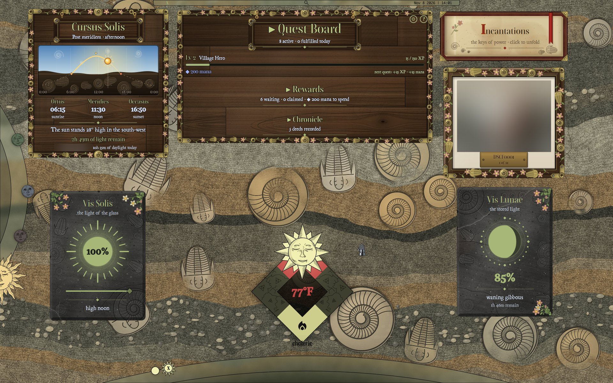

## Screenshots

### The five themes

| Eris | Eros | Hades |
|---|---|---|
| [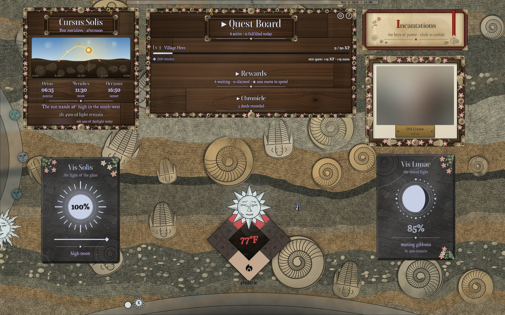](screenshots/desktop-eris.jpg) | [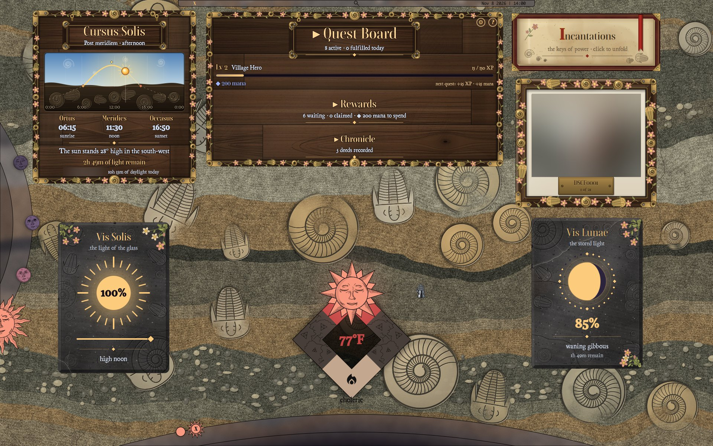](screenshots/desktop-eros.jpg) | [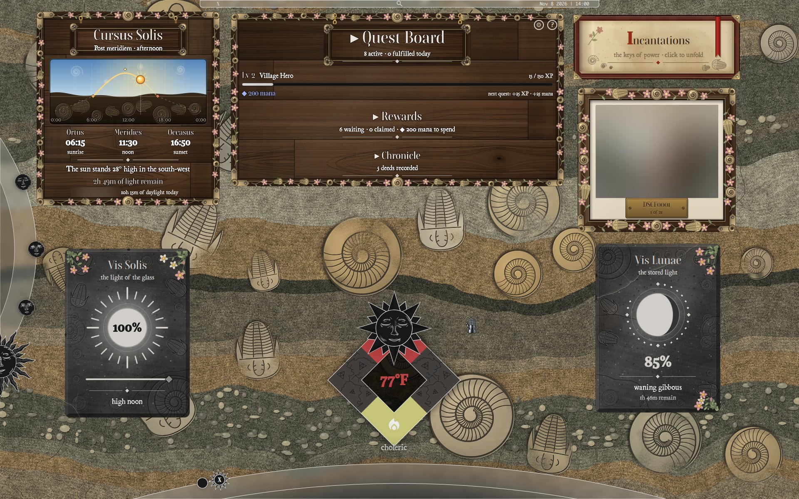](screenshots/desktop-hades.jpg) |
| **Helios** | **Priapus** | |
| [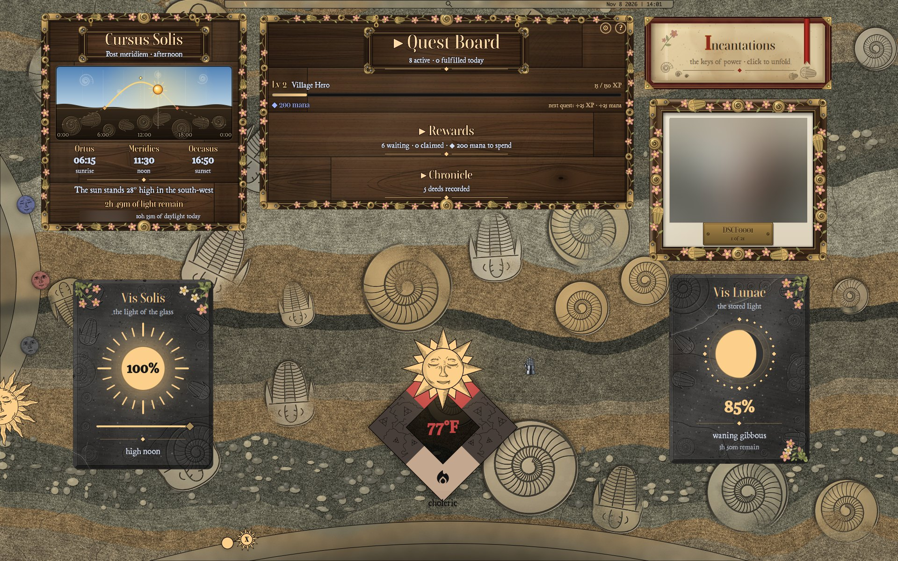](screenshots/desktop-helios.jpg) | [](screenshots/desktop-priapus.jpg) | |

Widgets shown: Cursus Solis, Quest Board, Incantations, the photo frame, Vis Solis, Vis Lunae,
and the weather badge. The photo and location are blurred in these shots.

### Screensaver: *Mare Antiquum*

Ammonites drift over a trilobite sea floor. It starts after 5 minutes idle via hypridle.

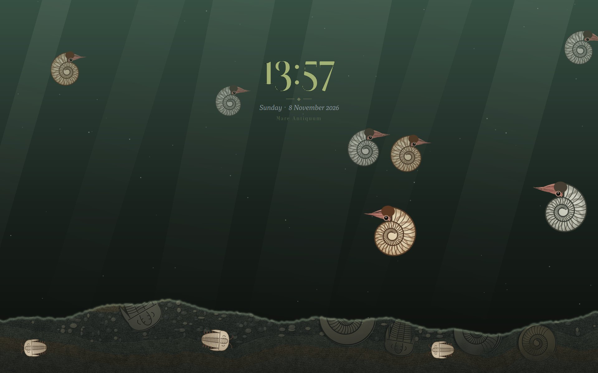

<details>
<summary>Screensaver in every theme</summary>

| Eris | Eros | Hades | Helios |
|---|---|---|---|
| 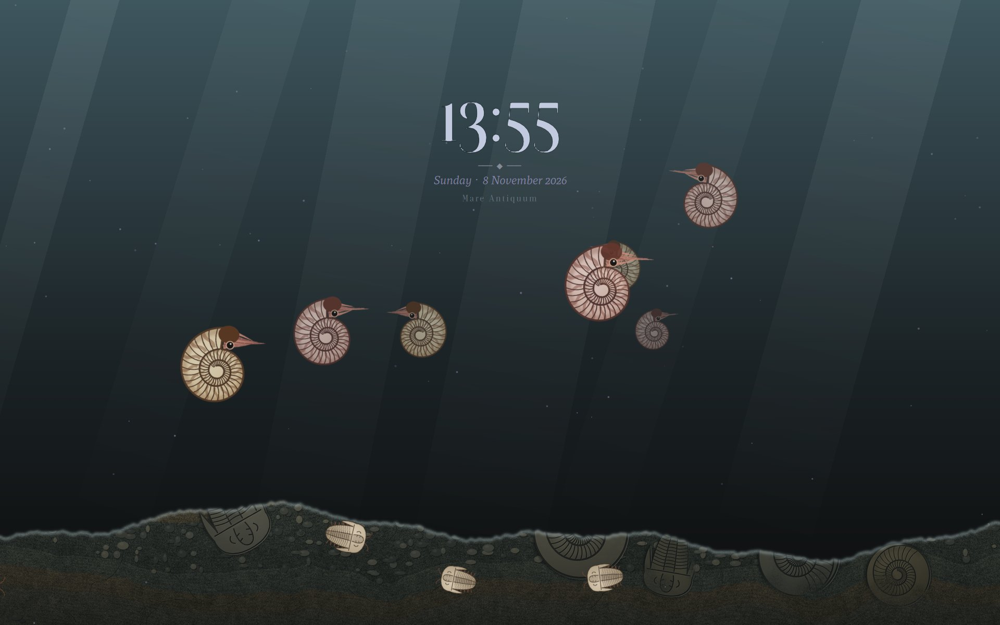 | 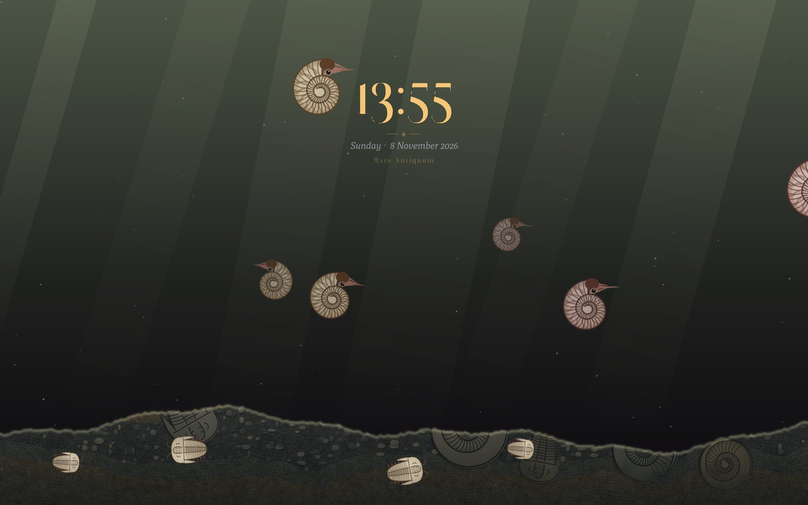 | 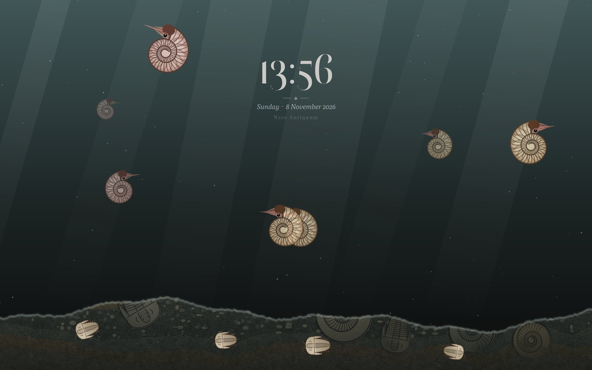 | 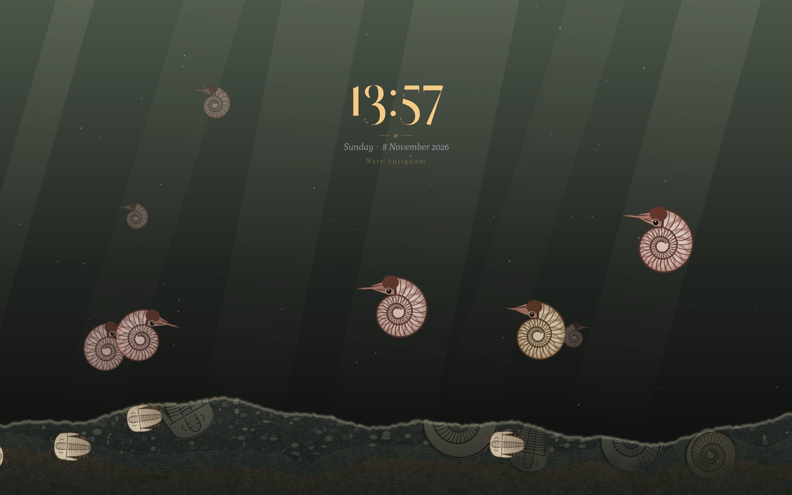 |

</details>

### Lock screen: *Sealed in Stone*

A carved fossil slab set into the wallpaper. `hypr/lock/make_lock.py` regenerates it for each theme,
and hyprlock draws the clock and password field into the groove.

| Eris | Hades | Helios | Priapus |
|---|---|---|---|
| 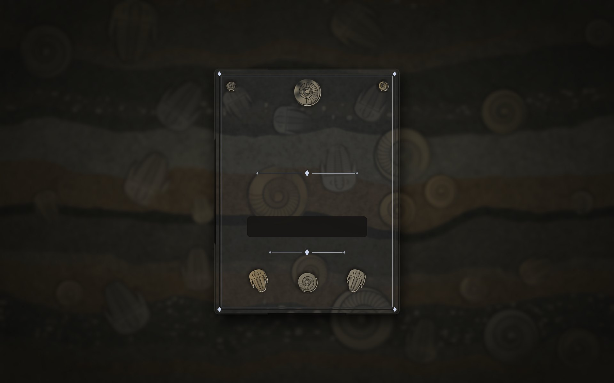 | 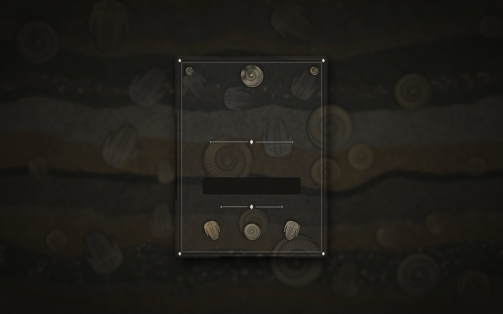 |  | 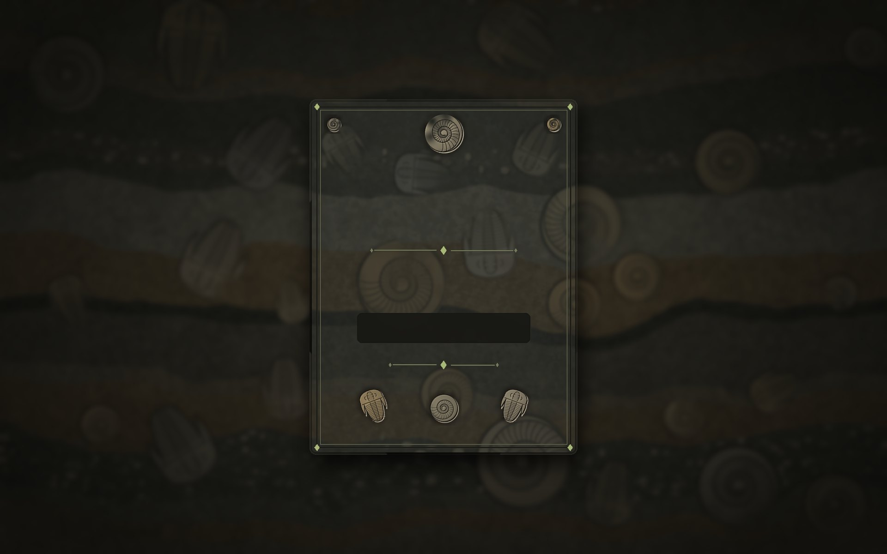 |

## What's here

| Folder | Goes to | What it is |
|---|---|---|
| `hypr/` | `~/.config/hypr` | Hyprland (`hyprland.lua`), hyprlock, hypridle, hyprpaper, lock-screen generator, wallpapers, and `theme-sync.sh` / `theme-apps.py` |
| `quickshell/` | `~/.config/quickshell` | Bar, sidebar, popups, widgets (quest board, hotkeys, weather, sun), fonts |
| `quickshell-screensaver/` | `~/.config/quickshell-screensaver` | Sea-floor fossil screensaver with sprites |
| `kitty/` | `~/.config/kitty` | kitty config + one color file per god |
| `mako/` | `~/.config/mako` | Notification styling |
| `gtk/` | `~/.gtkrc-2.0` | GTK 2 settings |
| `icons/` | `~/.local/share/icons` | Recolored icon themes (`*-Icons`), cursor themes (`*-Cursor`), `Gauntlet-Source` cursor base, and the scripts that build them |

## How theme switching works

1. Quickshell's `Config.qml` calls `hypr/theme-sync.sh THEME BASE ACCENT HIGHLIGHT` when the theme changes.
2. The script sets the Hyprland border colors live, regenerates the kitty and mako configs (`theme-apps.py`), and reloads them.
3. It rebuilds the cursor from `Gauntlet-Source` (`recolor_cursor.py`) if the colors changed, then points
   `Themed-Icons` at the matching recolored icon set (`recolor_icons.py`).

## Install

Requires: Hyprland, Quickshell, kitty, mako, hyprlock, hypridle, hyprpaper, Python 3 (with Pillow for the generator scripts).

```sh
git clone https://github.com/courtneyslittlecorner/fossil-rice && cd fossil-rice
cp -a hypr quickshell quickshell-screensaver kitty mako ~/.config/
cp -a icons/. ~/.local/share/icons/
cp gtk/.gtkrc-2.0 ~/
cp ~/.config/quickshell/settings.example.json ~/.config/quickshell/settings.json
```

Then put your own [OpenWeatherMap](https://openweathermap.org/api) API key and city in
`~/.config/quickshell/settings.json` to get the weather widget working.

## Credits & licenses

- **Icons:** `icons/buuf-nestort` and the five `*-Icons` themes recolored from it are
  *Buuf for Many Desktops* by Nestort, based on Paul Davey (Mattahan)'s Buuf artwork.
  They're licensed **CC BY-NC-SA 2.5** (non-commercial, share-alike). See `icons/buuf-nestort/README.md`.
- **Cursors:** the `*-Cursor` themes and `Gauntlet-Source` are built on the Bibata cursor theme, with gauntlet hands added.
- Everything else (configs, scripts, the screensaver, the lock screen, and generated wallpapers) is mine.

## Keeping it up to date

`sync.sh` copies the live config from `~/.config` and `~/.local/share/icons` back into this repo,
commits, and pushes. It skips backups and bytecode, and it won't push if a weather API key is staged.

```sh
rice-sync                     # sync + commit + push (symlinked into ~/.local/bin)
rice-sync "new Hades colors"  # with your own commit message
rice-sync --dry-run           # preview what would change
```
